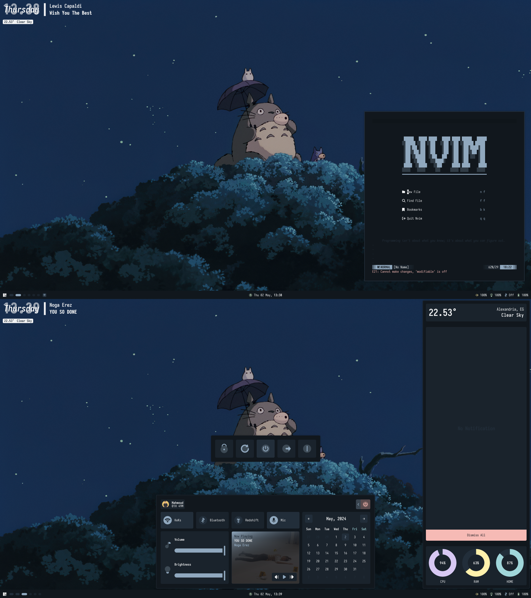

# NixOS System Configurations


NixOS system and home configurations for two hosts, managed with flakes and
[home-manager](https://github.com/nix-community/home-manager).

> I am no Nix expert.

## Screenshot



## Hosts

| Host        | Role                          | Notes                                                        |
| ----------- | ----------------------------- | ------------------------------------------------------------ |
| `labbi`     | Linux laptop (bare metal)     | Awesome WM, X11, systemd-boot, disko-managed disk, Docker    |
| `zanpakuto` | NixOS inside WSL (Windows)    | WSL interop, podman, Windows-side WezTerm                    |

Each host is a small **profile** in `flake.nix` (username, hostname, theme and
the `isWSL` / `disko` flags) plus two module trees:

- `hosts/<host>/` — the NixOS system configuration
- `home/<host>/` — the home-manager configuration

> [!CAUTION]
> These system and home configurations are public for learning and research.
> They are not meant to be used on any hardware other than mine. Trying to
> build and deploy them to other systems without appropriate changes can
> render your machines unbootable and damage data.

## Repository layout

```
├── flake.nix            # flake outputs + host profiles
├── lib/                 # mkHost / mkHome builders, colors
├── hosts/
│   ├── common/          # shared system modules (core / hardware / system)
│   ├── labbi/           # system config for the laptop
│   └── zanpakuto/       # system config for the WSL host
├── home/
│   ├── labbi/           # home-manager config for the laptop
│   └── zanpakuto/       # home-manager config for WSL
├── modules/
│   ├── programs/        # per-program modules (many with theme support)
│   ├── services/        # system services
│   └── themes/          # color themes + font definitions
├── disks/               # disko disk profiles (named layouts)
└── overlays/            # package overlays
```

## Installation

### labbi (bare-metal laptop)

The disk is (re)partitioned with [disko](https://github.com/nix-community/disko) —
the full layout, LUKS setup and one-time install steps are documented in
[`disks/README.md`](disks/README.md). Short version, from a NixOS live USB:

```shell
git clone <this-repo> /mnt/etc/nixos && cd /mnt/etc/nixos
# create the LUKS passphrase secret (see disks/README.md), then:
sudo nix run .#disko -- --mode disko ./disks/default.nix \
  --argstr device /dev/nvme0n1 --argstr passwordFile /tmp/labbi-luks-passphrase
sudo nixos-rebuild boot --flake '.#labbi'
```

### zanpakuto (WSL)

```shell
# From PowerShell
wsl --install -d NixOS

# Inside the NixOS distro
nixos-rebuild switch --flake 'github:<your-user>/<this-repo>#zanpakuto'
```

## Everyday usage

```shell
# Rebuild the system (home-manager is built into it)
nixos-rebuild switch --flake '.#labbi' # or '#zanpakuto'

# Rebuild the home configuration only
home-manager build --flake '.#labbi'

# Development shell
nix develop
```

## Disk layout (disko profiles)

Disk layouts are **named profiles** (like themes) in [`disks/`](disks/) —
selected per host with `diskProfile`, and at install time with
`--arg profile <name>`. There is one profile today, `luks-btrfs-home`:
LUKS2-encrypted btrfs root (`/`, `/nix`, `/persist`) plus an unencrypted
ext4 `/home`. The same profile is consumed by the disko CLI at install time
and by the NixOS module at evaluation time, so it is the single source of
truth for the layout.

The full documentation — layouts, LUKS + auto-decrypt, secret creation and
the one-time re-partition workflow — is in
[`disks/README.md`](disks/README.md).

## Themes

Themes live in [`modules/themes/`](modules/themes) and are selected per host
with the `theme` key on the profile (`melle` on labbi, `midnight` on
zanpakuto). Both the system configuration and the home-manager configuration
consume the same theme, and most program modules (wezterm, rofi, neovim, ...)
read their colors from it.

Available: `blaulicht`, `blind`, `bliss`, `benthic`, `bluewery`, `coral`,
`crystal`, `darkgit`, `fuji`, `iceberg`, `idx`, `jotai`, `kalt`, `kanagawa`,
`late`, `melle`, `mellow`, `midnight`, `momo`, `mongo`, `mountain`, `night`,
`oxo`, `poimandres`, `rnvy`, `rouge`, `seaul`, `techbase`, `tokyonight`,
`uwu`, `winter`, `yuro`.

## Adding a new host

1. Add a profile in `flake.nix` under `hosts`:
   `username`, `hostName`, `theme`, and `isWSL` / `disko` / `diskProfile` /
   `diskDevice` as needed.
2. Add `nixosConfigurations.<host>` and `homeConfigurations.<host>` entries
   (copy one of the existing hosts and adjust `extraModules`).
3. Create `hosts/<host>/configuration.nix` (importing the right subset of
   `hosts/common/`) and `home/<host>/home.nix`.
4. `git add .` and rebuild.

## Credits

- [nerdypepper](https://git.peppe.rs/config/nixos/about/)
- [JavaCafe01](https://github.com/JavaCafe01/frostedflakes)
- [Gvolpe](https://github.com/gvolpe/nix-config/)
- [redyf](https://github.com/redyf/nixdots)
- [linuxmobile](https://github.com/linuxmobile/kaku)
